<div align="center">


**English** · [Français](docs/i18n/README.fr.md) · [Español](docs/i18n/README.es.md) · [Deutsch](docs/i18n/README.de.md) · [Italiano](docs/i18n/README.it.md) · [Português](docs/i18n/README.pt-BR.md) · [日本語](docs/i18n/README.ja.md) · [中文](docs/i18n/README.zh-CN.md) · [Русский](docs/i18n/README.ru.md)

</div>

El1xr runs the Xbox Series version of Grand Theft Auto VI (build 1.0.2.1) on a Windows PC. It is Bone/Nevaa's project. The game's own x86-64 code runs natively on your processor. Its console system calls, Direct3D 12.X commands and RDNA 2 shaders are translated for the PC as the game runs. There is no CPU emulation and no game content in this repository: you bring your own copy.

## Status

> [!NOTE]
> **As of 27 November 2026, GTA VI (Xbox Series, build 1.0.2.1) boots, reaches the menus and is playable in the open world on Windows.** It runs at 24-25 fps once settled at 4K on an RTX 5090, with 0 refused GPU pipelines. The next goal is a steady 30 fps. After that come no hitches and no visual faults.


| Milestone | Status | Evidence | Date |
|---|---|---|---|
| Executable runs | Done | The Xbox Series 1.0.2.1 executable starts on Windows. Its x86-64 code runs natively. | by 24 Nov 2026 |
| First frame | Done | The startup animation and legal screens render without flicker. | by 24 Nov 2026 |
| Main menu | Done | Profile screen, first-run settings, legal screens, loading screen and pause menu all work. Menus run at 30 fps (RTX 4070 SUPER). | by 24 Nov 2026 |
| In-game | Done | The game reaches the open world and the character moves under player control. A 13-minute session in the prison ran at about 4 fps (RTX 4070 SUPER). | by 24 Nov 2026 |
| Playable | Done, below target speed | The world plays at 24-25 fps once settled at 4K (RTX 5090; three quiet benchmark runs at 24.9, 25.2 and 24.2 fps). | 27 Nov 2026 |
| Story progress | First two missions completed | A contributor completed the first two missions in a 45-minute session at about 2 fps (RTX 4070 SUPER; reported, not measured from logs). All cutscenes play in full. On Linux (Proton, RX 9070 XT), a 23-minute run got past the prologue into chapter 1. | 25 Nov 2026 |
| 30 fps | Not yet | 24-25 fps settled, about 40 ms median frame time against the 33.3 ms target (RTX 5090, 4K). | 27 Nov 2026 |
| Stable | In progress | With the default settings, 200-second benchmark runs finish with no crash, no GPU driver reset and no device loss. Visual faults still vary from run to run (see Known issues). | 27 Nov 2026 |

## Performance


| Measure (RTX 5090, 4K) | Now | Goal |
|---|---|---|
| Settled frame rate | **24-25 fps** | 30+ fps |
| Median frame time | ~40 ms | 33.3 ms or less |
| 99th-percentile frame | 68-73 ms | no hitches |
| CPU time to prepare a frame | 25-26 ms | under the GPU's time |
| Refused GPU pipelines | **0** | 0 |
| Launch to first world frame | ~31-33 s | |
| Worst freeze when entering the world | 1.5-1.9 s | none |
| Streaming after entering the world | 52-63 s | a few seconds |

Frame rate and frame times come from `python tools/dev.py bench --quiet --seconds 200`. Each run fast-boots from a fixed checkpoint with nothing else running on the machine, and the numbers are read from the emulator's own frame log. Launch time and the entry freeze come from runs made while the machine was busy compiling, so a quiet machine should do a little better.


A settled frame takes about 40 ms. The game's own rendering passes need 22.8 ms of GPU time, which leaves room for 30 fps. The rest is El1xr's own GPU work (7 ms: bounds checks on indirect draws, texture copies between formats, uploads) and time the GPU sits idle (6-10 ms) while one CPU thread prepares the next batch of work. Those two are what the next updates go after.


The update of 27 November 2026 stages textures without locks, prepares characters in parallel while loading and translates each shader as soon as the game creates it. Launch to the first world frame dropped from 41-54 s to 31-33 s, and the worst freeze when entering the world from 7.6-8.1 s to 1.5-1.9 s.

### Test machine

| Part | Model |
|---|---|
| GPU | NVIDIA GeForce RTX 5090, 32 GB, driver 621.24 |
| CPU | AMD Ryzen 9 9950X3D, 16 cores / 32 threads |
| Memory | 64 GB DDR5-6000 |
| Motherboard | MSI PRO B650-P WIFI |
| Storage | NVMe SSDs (Samsung 990 EVO Plus) |
| Operating system | Windows 11 (build 26200) |
| Game | GTA VI for Xbox Series, build 1.0.2.1 (your own copy) |

All current figures come from this machine. Older figures in this README were measured on an RTX 4070 SUPER (Windows) or an RX 9070 XT (Linux), and each one says so.

## How it works



- **Game code** is loaded and run as is. The Xbox Series and a Windows PC share the x86-64 instruction set, so no instruction is emulated.
- **System calls** to the console kernel and GDK libraries are served by El1xr's high-level emulation (HLE) on top of Windows: memory, threads, files and system services.
- **Graphics**: the console's Direct3D 12.X command lists, memory and resources are rebuilt as standard Direct3D 12 on your GPU.
- **Shaders** compiled for the console's RDNA 2 GPU are translated to DXIL. All 26,148 shader programs of the game translate, and each one is cached on disk after its first use.

## Run it

You need your own copy of the game, Windows 10 or 11, a GPU with Shader Model 6.6 and mesh shaders, and Rust.

```powershell
tools\lancer_victory.ps1 -GameDir <game folder>
```

The full guide (install, settings, troubleshooting) is in [docs/running-gta6.md](docs/running-gta6.md).

> [!IMPORTANT]
> This repository contains no game files, keys or executables, and does not explain how to get them.

<details>
<summary>Developer commands</summary>

```powershell
python tools/dev.py build      # release build
python tools/dev.py prewarm    # translate all shaders offline (about 45 s)
python tools/dev.py bench --quiet --seconds 200   # measured game run
python tools/dev.py gate       # every test, fails on any warning
```

</details>

## Known issues

- **Visual faults that vary from run to run.** In about half of test runs, faces turn black or blotched, Lucia wears the wrong outfit in the diner, or her hair turns orange at the prison window.
- **Slow streaming.** After entering the world it takes about a minute for every asset to arrive, with pop-in meanwhile.
- **The GPU waits on the CPU** for 6-10 ms per frame (see the frame budget above).
- **Ray-traced lighting is mostly off.** The game builds its ray-tracing structures in software, and that builder is disabled for now.
- **One reference machine.** Current figures are from the RTX 5090 above. Other GPUs have not been measured with the current build.

## What's next

The target is a steady 30 fps at 4K on the RTX 5090, then no hitches and no visual faults. About 60 more speed-ups are written and waiting to be measured. Each one is off by default until it is proven.

- **Memory in 2 MiB sections, game buffers kept in GPU memory, higher priority for the frame threads.** *In testing, single run (27 Nov 2026, RTX 5090):* 26.5 fps against 23.8 fps, settled in 92 s against 115 s, and memory unmapping 8 to 12 times cheaper. Two runs that combined it with three shader fixes hung the GPU at world entry, so it stays off until that is resolved.
- **Less waiting and less overhead**: cutting the 6-10 ms the GPU waits on the CPU each frame, and El1xr's own 7 ms of GPU work.
- **DLSS upscaling** and **hardware ray tracing on the RT cores**, which would bring back ray-traced lighting.
- **Offline shader and pipeline pre-warming**, so that no shader is compiled during play.
- **Fixes for the run-to-run faces and outfits**.

## In numbers

| Figure | What |
|---|---|
| 1700+ automated tests | Python tools and Rust crates, run by `dev.py gate` |
| 26,148 shader programs | translated from RDNA 2 to DXIL, cached on disk |
| 0 refused pipelines | on the RTX 5090 |

## Contributing

Issues and pull requests are welcome. Run `python tools/dev.py gate` before you open a pull request. The rules are in [CONTRIBUTING.md](CONTRIBUTING.md). Questions and test reports go to Bone/Nevaa on Discord: **bonemeld**.

## Credits

- **El1xr**: Bone/Nevaa.
- **VIctory**: Marvisak and its contributors ([VIctory](https://github.com/Marvisak/VIctory), GPL-3.0 or later), and the authors of the forks it was assembled from, including Neptune (VIctory Edit.) by Traffic & zm0kie.
- **AnyXboxX**: Looper_Salty and its contributors, the project El1xr was forked from.
- **The VIctory forks we learned from and ported from**, among them fxceless/victory-fork, Peppacodes, Belobug, stellarr-studio/kelvaroq, uiliannn/VItoriaBr, DoubleGhosty/cool_fox, avatarmanz, 3cvil/M1LK, trustno1-coder, TaynanGT/Vice-Tay, Linox-IDK/LNX-victory and readmet3xt-lab/foxhound.
- Every component and author, change by change, is credited in [THIRD_PARTY.md](THIRD_PARTY.md). The project's earlier history is in [docs/history.md](docs/history.md).

## License

El1xr is distributed under the [GNU GPL 3.0 or later](LICENSE). Third-party parts keep their own license: the `Task` module of libHttpClient (MIT, `runtime/third_party/libhttpclient-task`) and the RDNA 2 tables generated from LLVM's public encoding tests (Apache 2.0 with LLVM exception, `PrototypeScarlett/emu/rdna2_ops.py` and `rdna2_shapes.py`).
