<div align="center">


[English](../../README.md) · [Français](README.fr.md) · **Español** · [Deutsch](README.de.md) · [Italiano](README.it.md) · [Português](README.pt-BR.md) · [日本語](README.ja.md) · [中文](README.zh-CN.md) · [Русский](README.ru.md)

</div>

El1xr ejecuta la versión de Xbox Series de Grand Theft Auto VI (build 1.0.2.1) en un PC con Windows. Es el proyecto de Bone/Nevaa. El propio código x86-64 del juego se ejecuta de forma nativa en tu procesador. Sus llamadas al sistema de la consola, sus comandos Direct3D 12.X y sus shaders RDNA 2 se traducen para PC mientras el juego se ejecuta. No hay emulación de CPU ni contenido del juego en este repositorio: tienes que aportar tu propia copia.

## Estado

> [!NOTE]
> **A 27 de noviembre de 2026, GTA VI (Xbox Series, build 1.0.2.1) arranca, llega a los menús y es jugable en el mundo abierto en Windows.** Funciona a 24-25 fps una vez estabilizado, en 4K en una RTX 5090, con 0 pipelines de GPU rechazados. El siguiente objetivo son 30 fps estables. Después vendrá eliminar los tirones y los fallos visuales.


| Hito | Estado | Pruebas | Fecha |
|---|---|---|---|
| El ejecutable funciona | Hecho | El ejecutable de Xbox Series 1.0.2.1 arranca en Windows. Su código x86-64 se ejecuta de forma nativa. | a más tardar el 24 nov. 2026 |
| Primer fotograma | Hecho | La animación de inicio y las pantallas legales se muestran sin parpadeos. | a más tardar el 24 nov. 2026 |
| Menú principal | Hecho | La pantalla de perfil, los ajustes del primer arranque, las pantallas legales, la pantalla de carga y el menú de pausa funcionan. Los menús van a 30 fps (RTX 4070 SUPER). | a más tardar el 24 nov. 2026 |
| En partida | Hecho | El juego llega al mundo abierto y el personaje se mueve bajo el control del jugador. Una sesión de 13 minutos en la prisión funcionó a unos 4 fps (RTX 4070 SUPER). | a más tardar el 24 nov. 2026 |
| Jugable | Hecho, por debajo de la velocidad objetivo | El mundo se juega a 24-25 fps una vez estabilizado en 4K (RTX 5090; tres pruebas de rendimiento con el equipo en reposo: 24,9; 25,2 y 24,2 fps). | 27 nov. 2026 |
| Avance en la historia | Dos primeras misiones completadas | Un colaborador completó las dos primeras misiones en una sesión de 45 minutos a unos 2 fps (RTX 4070 SUPER; según su informe, no medido a partir de los registros). Todas las cinemáticas se reproducen completas. En Linux (Proton, RX 9070 XT), una prueba de 23 minutos superó el prólogo y llegó al capítulo 1. | 25 nov. 2026 |
| 30 fps | Todavía no | 24-25 fps una vez estabilizado, con un tiempo de fotograma mediano de unos 40 ms frente al objetivo de 33,3 ms (RTX 5090, 4K). | 27 nov. 2026 |
| Estable | En curso | Con los ajustes por defecto, las pruebas de rendimiento de 200 segundos terminan sin cierres, sin reinicios del controlador de la GPU y sin pérdida del dispositivo. Los fallos visuales todavía varían de una prueba a otra (ver Problemas conocidos). | 27 nov. 2026 |

## Rendimiento


| Medida (RTX 5090, 4K) | Ahora | Objetivo |
|---|---|---|
| Tasa de fotogramas estabilizada | **24-25 fps** | 30+ fps |
| Tiempo de fotograma mediano | ~40 ms | 33,3 ms o menos |
| Fotograma del percentil 99 | 68-73 ms | sin tirones |
| Tiempo de CPU para preparar un fotograma | 25-26 ms | por debajo del tiempo de la GPU |
| Pipelines de GPU rechazados | **0** | 0 |
| Del arranque al primer fotograma del mundo | ~31-33 s | |
| Peor congelamiento al entrar en el mundo | 1,5-1,9 s | ninguno |
| Streaming tras entrar en el mundo | 52-63 s | unos pocos segundos |

La tasa de fotogramas y los tiempos de fotograma proceden de `python tools/dev.py bench --quiet --seconds 200`. Cada prueba hace un arranque rápido desde un punto de control fijo, sin nada más ejecutándose en la máquina, y las cifras se leen del propio registro de fotogramas del emulador. El tiempo de arranque y el congelamiento al entrar proceden de pruebas hechas mientras la máquina estaba compilando, así que una máquina en reposo debería lograr algo mejor.


Un fotograma estabilizado tarda unos 40 ms. Las pasadas de renderizado del propio juego necesitan 22,8 ms de tiempo de GPU, lo que deja margen para los 30 fps. El resto se reparte entre el trabajo de GPU propio de El1xr (7 ms: comprobaciones de límites en los draws indirectos, copias de texturas entre formatos, subidas de datos) y el tiempo que la GPU pasa inactiva (6-10 ms) mientras un solo hilo de CPU prepara el siguiente lote de trabajo. Esas dos partidas son el objetivo de las próximas actualizaciones.



La actualización del 27 de noviembre de 2026 prepara las texturas sin bloqueos, precalcula los personajes en paralelo durante la carga y traduce cada shader en cuanto el juego lo crea. El tiempo desde el arranque hasta el primer fotograma del mundo bajó de 41-54 s a 31-33 s, y el peor congelamiento al entrar en el mundo, de 7,6-8,1 s a 1,5-1,9 s.

### Equipo de prueba

| Componente | Modelo |
|---|---|
| GPU | NVIDIA GeForce RTX 5090, 32 GB, controlador 621.24 |
| CPU | AMD Ryzen 9 9950X3D, 16 núcleos / 32 hilos |
| Memoria | 64 GB DDR5-6000 |
| Placa base | MSI PRO B650-P WIFI |
| Almacenamiento | SSD NVMe (Samsung 990 EVO Plus) |
| Sistema operativo | Windows 11 (build 26200) |
| Juego | GTA VI para Xbox Series, build 1.0.2.1 (tu propia copia) |

Todas las cifras actuales proceden de este equipo. Las cifras más antiguas de este README se midieron en una RTX 4070 SUPER (Windows) o en una RX 9070 XT (Linux), y en cada caso se indica.

## Cómo funciona


- **El código del juego** se carga y se ejecuta tal cual. La Xbox Series y un PC con Windows comparten el conjunto de instrucciones x86-64, así que no se emula ninguna instrucción.
- **Las llamadas al sistema** dirigidas al kernel de la consola y a las bibliotecas GDK las atiende la emulación de alto nivel (HLE) de El1xr sobre Windows: memoria, hilos, archivos y servicios del sistema.
- **Gráficos**: las listas de comandos Direct3D 12.X de la consola, su memoria y sus recursos se reconstruyen como Direct3D 12 estándar en tu GPU.
- **Los shaders** compilados para la GPU RDNA 2 de la consola se traducen a DXIL. Los 26.148 programas de shaders del juego se traducen todos, y cada uno se guarda en caché en disco tras su primer uso.

## Ejecútalo

Necesitas tu propia copia del juego, Windows 10 u 11, una GPU con Shader Model 6.6 y mesh shaders, y Rust.

```powershell
tools\lancer_victory.ps1 -GameDir <carpeta del juego>
```

La guía completa (instalación, ajustes, solución de problemas) está en [docs/running-gta6.md](../running-gta6.md).

> [!IMPORTANT]
> Este repositorio no contiene archivos del juego, claves ni ejecutables, y no explica cómo conseguirlos.

<details>
<summary>Comandos de desarrollo</summary>

```powershell
python tools/dev.py build      # compilación release
python tools/dev.py prewarm    # traduce todos los shaders sin conexión (unos 45 s)
python tools/dev.py bench --quiet --seconds 200   # partida medida
python tools/dev.py gate       # todos los tests, falla ante cualquier aviso
```

</details>

## Problemas conocidos

- **Fallos visuales que varían de una prueba a otra.** En aproximadamente la mitad de las pruebas, las caras salen negras o con manchas, Lucia lleva la ropa equivocada en el diner o su pelo se vuelve naranja en la ventana de la prisión.
- **Streaming lento.** Tras entrar en el mundo, todos los recursos tardan aproximadamente un minuto en llegar, con elementos que aparecen de golpe mientras tanto.
- **La GPU espera a la CPU** 6-10 ms por fotograma (ver el reparto del fotograma más arriba).
- **La iluminación con ray tracing está casi toda desactivada.** El juego construye sus estructuras de ray tracing por software, y ese constructor está desactivado por ahora.
- **Un único equipo de referencia.** Las cifras actuales proceden de la RTX 5090 indicada arriba. Las demás GPU no se han medido con la build actual.

## Próximos pasos

El objetivo son 30 fps estables en 4K en la RTX 5090, y después eliminar los tirones y los fallos visuales. Hay unas 60 aceleraciones más escritas y pendientes de medir. Cada una permanece desactivada por defecto hasta que demuestre su eficacia.

- **Memoria en secciones de 2 MiB, búferes del juego mantenidos en la memoria de la GPU y mayor prioridad para los hilos de fotograma.** *En pruebas, una sola ejecución (27 nov. 2026, RTX 5090):* 26,5 fps frente a 23,8 fps, estabilización en 92 s frente a 115 s, y una liberación de los mapeos de memoria entre 8 y 12 veces más barata. Dos ejecuciones que lo combinaban con tres correcciones de shaders bloquearon la GPU al entrar en el mundo, así que seguirá desactivado hasta que se resuelva.
- **Menos esperas y menos sobrecarga**: recortar los 6-10 ms que la GPU espera a la CPU en cada fotograma y los 7 ms de trabajo de GPU propio de El1xr.
- **Escalado DLSS** y **ray tracing por hardware en los núcleos RT**, que permitiría recuperar la iluminación con ray tracing.
- **Precalentamiento sin conexión de shaders y pipelines**, para que no se compile ningún shader durante la partida.
- **Correcciones para las caras y la ropa que varían de una prueba a otra**.

## El proyecto en cifras

| Cifra | Qué |
|---|---|
| 1600+ pruebas automatizadas | herramientas de Python y crates de Rust, ejecutadas por `dev.py gate` |
| 26.148 programas de shaders | traducidos de RDNA 2 a DXIL, en caché en disco |
| 0 pipelines rechazados | en la RTX 5090 |

## Contribuir

Las issues y las pull requests son bienvenidas. Ejecuta `python tools/dev.py gate` antes de abrir una pull request. Las normas están en [CONTRIBUTING.md](../../CONTRIBUTING.md). Las preguntas y los informes de pruebas van dirigidos a Bone/Nevaa en Discord: **bonemeld**.

## Créditos

- **El1xr**: Bone/Nevaa.
- **VIctory**: Marvisak y sus colaboradores ([VIctory](https://github.com/Marvisak/VIctory), GPL-3.0 o posterior), y los autores de los forks a partir de los que se ensambló, entre ellos Neptune (VIctory Edit.) de Traffic & zm0kie.
- **AnyXboxX**: Looper_Salty y sus colaboradores, el proyecto del que El1xr es un fork.
- **Los forks de VIctory de los que hemos aprendido y portado código**, entre ellos fxceless/victory-fork, Peppacodes, Belobug, stellarr-studio/kelvaroq, uiliannn/VItoriaBr, DoubleGhosty/cool_fox, avatarmanz, 3cvil/M1LK, trustno1-coder, TaynanGT/Vice-Tay, Linox-IDK/LNX-victory y readmet3xt-lab/foxhound.
- Cada componente y cada autor, cambio por cambio, se acredita en [THIRD_PARTY.md](../../THIRD_PARTY.md). La historia anterior del proyecto está en [docs/history.md](../history.md).

## Licencia

El1xr se distribuye bajo la [GNU GPL 3.0 o posterior](../../LICENSE). Las partes de terceros conservan su propia licencia: el módulo `Task` de libHttpClient (MIT, `runtime/third_party/libhttpclient-task`) y las tablas RDNA 2 generadas a partir de las pruebas públicas de codificación de LLVM (Apache 2.0 con excepción LLVM, `PrototypeScarlett/emu/rdna2_ops.py` y `rdna2_shapes.py`).
