<div align="center">


[English](../../README.md) · [Français](README.fr.md) · [Español](README.es.md) · [Deutsch](README.de.md) · [Italiano](README.it.md) · [Português](README.pt-BR.md) · **日本語** · [中文](README.zh-CN.md) · [Русский](README.ru.md)

</div>

El1xr は、Xbox Series 版 Grand Theft Auto VI（ビルド 1.0.2.1）を Windows PC で動かすプロジェクトで、Bone/Nevaa が手がけています。ゲーム自身の x86-64 コードはお使いのプロセッサー上でネイティブに実行され、コンソールのシステムコール、Direct3D 12.X のコマンド、RDNA 2 シェーダーは、ゲームの実行中に PC 向けに変換されます。CPU のエミュレーションは行わず、このリポジトリにゲームのコンテンツは一切含まれていません。ゲームはご自身のコピーをご用意ください。

## 現状

> [!NOTE]
> **2026 年 11 月 27 日時点で、GTA VI（Xbox Series、ビルド 1.0.2.1）は Windows 上で起動し、メニューに到達し、オープンワールドでプレイできます。** RTX 5090 の 4K で、安定後は 24-25 fps で動作し、拒否された GPU パイプラインは 0 です。次の目標は安定した 30 fps、その先はカクつきと表示の不具合の解消です。


| マイルストーン | 状態 | 根拠 | 日付 |
|---|---|---|---|
| 実行ファイルの起動 | 完了 | Xbox Series 1.0.2.1 の実行ファイルが Windows 上で起動します。その x86-64 コードはネイティブに実行されます。 | 2026 年 11 月 24 日までに |
| 最初のフレーム | 完了 | 起動アニメーションと法的表示の画面が、ちらつきなく描画されます。 | 2026 年 11 月 24 日までに |
| メインメニュー | 完了 | プロフィール画面、初回起動時の設定、法的表示の画面、ロード画面、ポーズメニューがすべて動作します。メニューは 30 fps で動作します（RTX 4070 SUPER）。 | 2026 年 11 月 24 日までに |
| ゲーム内 | 完了 | ゲームはオープンワールドに到達し、キャラクターはプレイヤーの操作どおりに動きます。刑務所での 13 分間のセッションは約 4 fps でした（RTX 4070 SUPER）。 | 2026 年 11 月 24 日までに |
| プレイ可能 | 完了（目標速度には未達） | 安定後、ワールドは 4K・24-25 fps でプレイできます（RTX 5090。他の負荷のない状態でのベンチマーク 3 回：24.9、25.2、24.2 fps）。 | 2026 年 11 月 27 日 |
| ストーリーの進行 | 最初の 2 ミッションをクリア | あるコントリビューターが、約 2 fps の 45 分間のセッションで最初の 2 つのミッションをクリアしました（RTX 4070 SUPER。本人の報告であり、ログからの計測ではありません）。カットシーンはすべて最後まで再生されます。Linux（Proton、RX 9070 XT）では、23 分間の実行でプロローグを抜けて第 1 章まで進みました。 | 2026 年 11 月 25 日 |
| 30 fps | 未達成 | 安定後 24-25 fps。フレーム時間の中央値は、目標の 33.3 ms に対して約 40 ms です（RTX 5090、4K）。 | 2026 年 11 月 27 日 |
| 安定性 | 取り組み中 | 既定の設定では、200 秒のベンチマーク実行がクラッシュ、GPU ドライバーのリセット、デバイスの喪失なしで完走します。表示の不具合は、まだ実行ごとに変わります（「既知の問題」を参照）。 | 2026 年 11 月 27 日 |

## パフォーマンス


| 指標（RTX 5090、4K） | 現在 | 目標 |
|---|---|---|
| 安定後のフレームレート | **24-25 fps** | 30+ fps |
| フレーム時間の中央値 | ~40 ms | 33.3 ms 以下 |
| 99 パーセンタイルのフレーム | 68-73 ms | カクつきなし |
| 1 フレームの準備にかかる CPU 時間 | 25-26 ms | GPU の時間未満 |
| 拒否された GPU パイプライン | **0** | 0 |
| 起動からワールドの最初のフレームまで | ~31-33 s | |
| ワールドに入るときの最悪のフリーズ | 1.5-1.9 s | なし |
| ワールドに入った後のストリーミング | 52-63 s | 数秒 |

フレームレートとフレーム時間は `python tools/dev.py bench --quiet --seconds 200` で計測しています。各実行は固定のチェックポイントから高速起動し、マシン上では他に何も動かさず、数値はエミュレーター自身のフレームログから読み取っています。起動時間とワールドに入るときのフリーズは、マシンがコンパイルで忙しい間に行った実行から得たもので、静かなマシンならもう少し良くなるはずです。


安定後の 1 フレームは約 40 ms かかります。ゲーム自身の描画パスが使う GPU 時間は 22.8 ms なので、30 fps に届く余地は十分にあります。残りは El1xr 自身の GPU 処理（7 ms：間接描画の範囲チェック、フォーマット間のテクスチャコピー、アップロード）と、CPU の 1 スレッドが次の処理バッチを準備している間の GPU のアイドル時間（6-10 ms）です。今後のアップデートでは、この 2 つを削減します。


2026 年 11 月 27 日のアップデートでは、テクスチャのステージングをロックなしで行い、ロード中にキャラクターの準備を並列で進め、ゲームがシェーダーを作成した時点ですぐに変換するようにしました。これにより、起動からワールドの最初のフレームまでが 41-54 秒から 31-33 秒に、ワールドに入るときの最悪のフリーズが 7.6-8.1 秒から 1.5-1.9 秒に短縮されました。

### テスト環境

| パーツ | モデル |
|---|---|
| GPU | NVIDIA GeForce RTX 5090、32 GB、ドライバー 621.24 |
| CPU | AMD Ryzen 9 9950X3D、16 コア / 32 スレッド |
| メモリ | 64 GB DDR5-6000 |
| マザーボード | MSI PRO B650-P WIFI |
| ストレージ | NVMe SSD（Samsung 990 EVO Plus） |
| OS | Windows 11（ビルド 26200） |
| ゲーム | Xbox Series 版 GTA VI、ビルド 1.0.2.1（ご自身のコピー） |

現在の数値はすべてこのマシンで計測したものです。この README にある以前の数値は RTX 4070 SUPER（Windows）または RX 9070 XT（Linux）で計測したもので、それぞれその旨を明記しています。

## 仕組み



- **ゲームコード**はそのまま読み込まれ、実行されます。Xbox Series と Windows PC は同じ x86-64 命令セットを共有しているため、命令を 1 つもエミュレートする必要がありません。
- **システムコール**（コンソールのカーネルと GDK ライブラリへの呼び出し）は、Windows 上で動く El1xr の高レベルエミュレーション（HLE）が処理します。対象はメモリ、スレッド、ファイル、システムサービスです。
- **グラフィックス**：コンソールの Direct3D 12.X のコマンドリスト、メモリ、リソースは、お使いの GPU 上で標準の Direct3D 12 として再構築されます。
- **シェーダー**：コンソールの RDNA 2 GPU 向けにコンパイルされたシェーダーは DXIL に変換されます。ゲームの全 26,148 個のシェーダープログラムが変換でき、それぞれ初回使用後にディスクへキャッシュされます。

## 実行方法

ご自身のゲームのコピー、Windows 10 または 11、Shader Model 6.6 とメッシュシェーダーに対応した GPU、そして Rust が必要です。

```powershell
tools\lancer_victory.ps1 -GameDir <ゲームのフォルダー>
```

完全なガイド（インストール、設定、トラブルシューティング）は [docs/running-gta6.md](../running-gta6.md) にあります。

> [!IMPORTANT]
> このリポジトリにはゲームファイル、鍵、実行ファイルは含まれておらず、それらの入手方法も説明していません。

<details>
<summary>開発者向けコマンド</summary>

```powershell
python tools/dev.py build      # リリースビルド
python tools/dev.py prewarm    # 全シェーダーをオフラインで変換（約 45 s）
python tools/dev.py bench --quiet --seconds 200   # 計測付きのゲーム実行
python tools/dev.py gate       # 全テスト、警告が 1 つでもあれば失敗
```

</details>

## 既知の問題

- **実行ごとに変わる表示の不具合**：テスト実行の約半数で、顔が黒くなったりまだらになったり、ダイナーでルシアの服装が間違っていたり、刑務所の窓で髪がオレンジ色になったりします。
- **遅いストリーミング**：ワールドに入ってからすべてのアセットが揃うまで約 1 分かかり、その間はポップインが発生します。
- **CPU を待つ GPU**：1 フレームあたり 6-10 ms（上記の 1 フレームの内訳を参照）。
- **レイトレーシングによるライティングはほぼオフ**：ゲームはレイトレーシング用の構造をソフトウェアで構築しており、そのビルダーは現在無効になっています。
- **基準となるマシンは 1 台のみ**：現在の数値は上記の RTX 5090 によるものです。他の GPU は、現在のビルドではまだ計測していません。

## 今後の予定

目標は RTX 5090 の 4K で安定した 30 fps を出し、その上でカクつきと表示の不具合をなくすことです。さらに約 60 件の高速化が実装済みで、計測を待っています。いずれも効果が実証されるまでは既定でオフです。

- **メモリの 2 MiB 単位のセクション化、ゲームのバッファーの GPU メモリへの保持、フレームスレッドの優先度引き上げ。** *テスト中・1 回のみの実行（2026 年 11 月 27 日、RTX 5090）：* 23.8 fps に対して 26.5 fps、安定までの時間は 115 秒に対して 92 秒、メモリのアンマップのコストは 8-12 分の 1 になりました。これを 3 つのシェーダー修正と組み合わせた 2 回の実行では、ワールドに入る時点で GPU がハングしたため、その問題が解決するまではオフのままにします。
- **待ち時間とオーバーヘッドの削減**：GPU が毎フレーム CPU を待つ 6-10 ms と、El1xr 自身の 7 ms の GPU 処理を削ります。
- **DLSS アップスケーリング**と **RT コアによるハードウェアレイトレーシング**。後者により、レイトレーシングによるライティングが復活します。
- **シェーダーとパイプラインのオフライン事前ウォームアップ**。プレイ中にシェーダーがコンパイルされることをなくします。
- **実行ごとに変わる顔と服装の不具合の修正**。

## 数字で見るプロジェクト

| 数値 | 内容 |
|---|---|
| 1800+ 件の自動テスト | Python のツールと Rust のクレート、`dev.py gate` で実行 |
| 26,148 個のシェーダープログラム | RDNA 2 から DXIL に変換し、ディスクにキャッシュ |
| 0 件の拒否されたパイプライン | RTX 5090 上 |

## 貢献

issue とプルリクエストを歓迎します。プルリクエストを開く前に `python tools/dev.py gate` を実行してください。ルールは [CONTRIBUTING.md](../../CONTRIBUTING.md) にあります。質問やテスト報告は、Discord で Bone/Nevaa（**bonemeld**）までお寄せください。

## クレジット

- **El1xr**：Bone/Nevaa。
- **VIctory**：Marvisak とそのコントリビューター（[VIctory](https://github.com/Marvisak/VIctory)、GPL-3.0 以降）、および VIctory の組み立てに使われたフォークの作者たち。その中には Traffic & zm0kie による Neptune (VIctory Edit.) も含まれます。
- **AnyXboxX**：Looper_Salty とそのコントリビューター。El1xr のフォーク元のプロジェクトです。
- **私たちが学び、移植元とした VIctory のフォーク**：fxceless/victory-fork、Peppacodes、Belobug、stellarr-studio/kelvaroq、uiliannn/VItoriaBr、DoubleGhosty/cool_fox、avatarmanz、3cvil/M1LK、trustno1-coder、TaynanGT/Vice-Tay、Linox-IDK/LNX-victory、readmet3xt-lab/foxhound など。
- すべてのコンポーネントと作者は、変更ごとに [THIRD_PARTY.md](../../THIRD_PARTY.md) に記載されています。プロジェクトのこれまでの歩みは [docs/history.md](../history.md) にあります。

## ライセンス

El1xr は [GNU GPL 3.0 以降](../../LICENSE) の下で配布されています。サードパーティの部分はそれぞれ独自のライセンスを保持します：libHttpClient の `Task` モジュール（MIT、`runtime/third_party/libhttpclient-task`）と、LLVM の公開エンコーディングテストから生成された RDNA 2 のテーブル（Apache 2.0 with LLVM exception、`PrototypeScarlett/emu/rdna2_ops.py` と `rdna2_shapes.py`）。
