<div align="center">


[English](../../README.md) · [Français](README.fr.md) · [Español](README.es.md) · [Deutsch](README.de.md) · [Italiano](README.it.md) · **Português** · [日本語](README.ja.md) · [中文](README.zh-CN.md) · [Русский](README.ru.md)

</div>

O El1xr roda a versão de Xbox Series de Grand Theft Auto VI (build 1.0.2.1) em um PC com Windows. É o projeto de Bone/Nevaa. O próprio código x86-64 do jogo roda nativamente no seu processador. As chamadas de sistema do console, os comandos Direct3D 12.X e os shaders RDNA 2 são traduzidos para o PC enquanto o jogo roda. Não há emulação de CPU nem conteúdo do jogo neste repositório: você usa a sua própria cópia.

## Status

> [!NOTE]
> **Em 28 de novembro de 2026, GTA VI (Xbox Series, build 1.0.2.1) inicializa, chega aos menus e é jogável no mundo aberto no Windows.** Nas últimas execuções de teste com a máquina sem outra carga (lote 5, 4K, RTX 5090), o jogo roda a 21,6-22,4 fps em execuções de 110 segundos a partir da inicialização e a 25,8-26,0 fps em execuções de 180 e 460 segundos. Isso ainda fica abaixo da próxima meta, 30 fps estáveis. Depois disso vêm a eliminação dos engasgos e das falhas visuais.



| Marco | Status | Evidência | Data |
|---|---|---|---|
| Executável roda | Concluído | O executável 1.0.2.1 de Xbox Series inicia no Windows. Seu código x86-64 roda nativamente. | até 24/11/2026 |
| Primeiro quadro | Concluído | A animação de abertura e as telas legais são renderizadas sem cintilação. | até 24/11/2026 |
| Menu principal | Concluído | Tela de perfil, configurações da primeira execução, telas legais, tela de carregamento e menu de pausa funcionam. Os menus rodam a 30 fps (RTX 4070 SUPER). | até 24/11/2026 |
| Jogo em andamento | Concluído | O jogo chega ao mundo aberto e o personagem se move sob o controle do jogador. Uma sessão de 13 minutos na prisão rodou a cerca de 4 fps (RTX 4070 SUPER). | até 24/11/2026 |
| Jogável | Concluído, abaixo da velocidade-alvo | O jogo roda a 21,6-26,0 fps em 4K (RTX 5090; execuções de 110 a 460 segundos do lote 5, com a máquina sem outra carga). | 28/11/2026 |
| Progresso na história | Duas primeiras missões concluídas | Um colaborador concluiu as duas primeiras missões em uma sessão de 45 minutos a cerca de 2 fps (RTX 4070 SUPER; relatado, não medido a partir dos logs). Todas as cutscenes são reproduzidas por inteiro. No Linux (Proton, RX 9070 XT), uma execução de 23 minutos passou do prólogo e chegou ao capítulo 1. | 25/11/2026 |
| 30 fps | Ainda não | 21,6-26,0 fps, ou 38-46 ms por quadro, contra a meta de 33,3 ms (RTX 5090, 4K). | 28/11/2026 |
| Estável | Em andamento | Com as configurações padrão, as execuções de teste do lote 5 não tiveram reset do driver de GPU nem perda do dispositivo. A parada de 8-9 s ao entrar no mundo, vista em 5 de 5 execuções no início do lote 5, não voltou nas 47 inicializações verificadas depois que os registros indiretos brutos passaram a ser verificados. O jogo ainda pode cair quando o Windows fica sem memória de commit, e as falhas visuais ainda variam de uma execução para outra (veja Problemas conhecidos). | 28/11/2026 |

## Desempenho


| Medida (RTX 5090, 4K) | Agora | Meta |
|---|---|---|
| Taxa de quadros, execuções de 110 s a partir da inicialização | **21,6-22,4 fps** | 30+ fps |
| Taxa de quadros, execuções de 180 s e 460 s | **25,8-26,0 fps** | 30+ fps |
| Tempo de CPU para preparar um quadro | 15,7-21,2 ms | abaixo do tempo da GPU |
| Pipelines de GPU recusados | 1 | 0 |
| Da inicialização ao primeiro quadro do mundo | 23,1-24,6 s | |
| Parada ao entrar no mundo | nenhuma em 47 inicializações; pior quadro de uma execução 771-832 ms | sem engasgos |
| Quadros acima de 250 ms no mundo | 3-6 por execução de 110 s | nenhum |
| Escurecimentos de um quadro na lanchonete | 0 (eram 12-19 por execução) | nenhum |
| Memória de buffers de GPU após 180 s | 2,9 GB (eram 4,5 GB) | |

Esses números vêm do lote 5 (concluído em 28 de novembro de 2026), com os switches que o inicializador agora liga. Todas as execuções foram feitas com a máquina sem outra carga: o resto do trabalho da máquina ficou pausado ou contido, o jogo fez uma inicialização rápida a partir de um checkpoint fixo, e os números foram lidos do próprio log de quadros do emulador (taxa de quadros e tempo de CPU são medianas sobre a segunda metade dos quadros de cada execução no mundo). Os números de 110 segundos vêm de dois pares de execuções de carregamento feitas em sequência, o de 180 segundos do par de `CARD_BLOCK_REUSE`, e o de 460 segundos de uma inicialização de teste de CPU. A taxa de quadros depende da cena e da duração da execução, então compare números apenas dentro de um mesmo par. Parte dos logs de diagnóstico estava ligada em todas as execuções.


O último perfil de tempos de GPU, feito antes do lote 3, indicava cerca de 40 ms por quadro estabilizado, dos quais os passes de renderização do próprio jogo precisam de 22,8 ms. O lote 5 mostrou que o quadro agora é limitado pelo trabalho de CPU que o prepara e o envia, e não pela GPU: com o DLSS renderizando a dois terços de 4K, a taxa de quadros real ficou em 21,8-22,0 fps, a mesma do 4K nativo (20,1-22,2 fps). Por isso, a maior parte das mudanças mantidas no lote 5 reduz o tempo de CPU por quadro.


O lote 5 manteve estas mudanças, agora ligadas por padrão no inicializador. Os switches dos lotes 3 e 4 continuam ligados.

- **Carregamento mais rápido** (`VICTORY_TEXTURE_HEAPS=1`, `VICTORY_TEXTURE_BLOCK_THREAD=1`, `VICTORY_DSTORAGE_STAGING_MB=256`, `VICTORY_DSTORAGE_POLL_WAIT=1`, `VICTORY_BAKE_STAGE_ALL=1`): as texturas em streaming compartilham grandes blocos de memória criados em uma thread própria, até 256 MiB de leituras do DirectStorage ficam em andamento em vez de 32, a consulta do jogo por leituras de disco concluídas retorna assim que elas terminam, e os passes de bake são preparados juntos durante o carregamento. No par de confirmação sem outra carga, o tempo da inicialização ao primeiro quadro do mundo caiu de 26,7 para 24,6 s, da inicialização ao primeiro quadro completo do mundo de 29,2 para 26,2 s, e o pior quadro de 1049 para 832 ms, com a mesma taxa de quadros. O primeiro par concordou (de 26,2 para 23,1 s).
- **Cintilação da lanchonete corrigida** (`VICTORY_TABLE_NULL_ONCE=1`): na lanchonete, o fundo escurecia por um quadro a cada cerca de 2 s, 12-19 vezes por execução. Uma tabela de descritores esvaziava o slot de uma textura toda vez que o trabalho de preparação dessa textura era descartado; agora um slot é esvaziado no máximo uma vez. Com o switch ligado, nenhum quadro assim apareceu em uma execução de 110 segundos nem em dois trechos de teste de 18 segundos, sem custo medido.
- **Fim da parada ao entrar no mundo** (`VICTORY_RAW_CHECK=2`): os registros de draws indiretos escritos pelos shaders do jogo são verificados antes de serem executados. No início do lote 5, toda execução congelava por 8,2-9,0 s cerca de 4 s depois de entrar no mundo (5 de 5); nenhuma das 47 inicializações verificadas depois dessa mudança parou.
- **Menos tempo de CPU por quadro**:
  - `VICTORY_SKIP_WC_BACK=1`: grandes escritas de shaders em memória write-combining ficam na placa em vez de serem copiadas de volta. 24,6 fps em 2 de 2 execuções, contra 21,5 fps na melhor execução sem outra carga sem ele, e 7,3 ms a menos de tempo de CPU por quadro.
  - `VICTORY_CARD_BLOCK_REUSE=1`: os pedaços de memória de GPU são zerados e reutilizados em vez de alocados de novo. De 23,6 para 26,0 fps em um par de 180 segundos sem outra carga, com 2,9 GB de memória de buffers de GPU no fim em vez de 4,5 GB.
  - `VICTORY_SEND_THREAD=1` e `VICTORY_CARD_RECORD_SEND=1`: as listas de comandos são enviadas, e as listas de sincronização de GPU gravadas, em uma thread própria. O tempo de envio na thread do quadro caiu de 1,56 para 0,11 ms.
  - `VICTORY_FLUSH_BESIDE=1`, `VICTORY_RESET_ASIDE=1`, `VICTORY_COPIED_SHARED=1`, `VICTORY_TEXTURE_HASH_BEHIND=1`, `VICTORY_RESULT_RING=1`, e `VICTORY_WIDE_WAKE_ONE=1` com `VICTORY_WAIT_SPIN=50`: cortes menores, de 0,5-1,8 ms de tempo de CPU por quadro cada, ou de até 1,4 fps, medidos ligando e desligando cada um dentro de uma única execução.
- **Entrada mais rápida no mundo** (`VICTORY_HEAP_WARM=1`): as cópias no host dos heaps de views do jogo são feitas na tela de carregamento, então o primeiro quadro do mundo levou 614 ms em vez de 1048 ms (segundo par; no primeiro par, de 781 para 702 ms).
- **Menos quadros lentos** (`VICTORY_AMBIENT_ONCE=1`): o substituto da iluminação ambiente do jogo conta um único rebote. O tempo de quadro no percentil 99 ficou 11 ms menor em um teste dentro da mesma execução.

O upscaling em 4K não trava mais o jogo: três inicializações com upscaling rodaram sem divisão por zero (0xc0000094). O upscaling DLSS fica nítido, mas não aumenta a taxa de quadros, porque o quadro espera pela CPU. A geração de quadros do DLSS (`-FrameGen`, ou Frame generation = dlss no menu F9) apresenta cerca de 44-47 fps a partir de 22-24 quadros reais; ela fica desligada por padrão até que os quadros gerados sejam verificados a olho. O lote 5 também descartou switches que quebravam algo ou custavam velocidade, entre eles `PIPELINE_PIECES` (tela preta), `BAKE_SPREAD=12` (1,2-2,2 fps mais lento) e `GUARD_PUBLISH_TRY` (uma queda). O construtor de ray tracing do jogo funciona quando ligado, mas roda a 0,6-1,1 fps, então continua desligado.

### Máquina de teste

| Componente | Modelo |
|---|---|
| GPU | NVIDIA GeForce RTX 5090, 32 GB, driver 621.24 |
| CPU | AMD Ryzen 9 9950X3D, 16 núcleos / 32 threads |
| Memória | 64 GB DDR5-6000 |
| Arquivo de paginação | 64 GB (limite de commit de 142 GB) |
| Placa-mãe | MSI PRO B650-P WIFI |
| Armazenamento | SSDs NVMe (Samsung 990 EVO Plus) |
| Sistema operacional | Windows 11 (build 26200) |
| Jogo | GTA VI para Xbox Series, build 1.0.2.1 (sua própria cópia) |

Todos os números atuais vêm desta máquina. Os números mais antigos deste README foram medidos em uma RTX 4070 SUPER (Windows) ou em uma RX 9070 XT (Linux), e cada um deles indica isso.

## Como funciona


- **O código do jogo** é carregado e executado como está. O Xbox Series e um PC com Windows compartilham o conjunto de instruções x86-64, então nenhuma instrução é emulada.
- **As chamadas de sistema** ao kernel do console e às bibliotecas do GDK são atendidas pela emulação de alto nível (HLE) do El1xr sobre o Windows: memória, threads, arquivos e serviços do sistema.
- **Leituras de disco**: as requisições DirectStorage do jogo são atendidas pelas próprias threads de trabalho do El1xr, com até 256 MiB em andamento. As texturas em streaming são colocadas em blocos de memória compartilhados: cerca de 115.000 texturas em 116 blocos em uma execução típica.
- **Gráficos**: as listas de comandos Direct3D 12.X, a memória e os recursos do console são reconstruídos como Direct3D 12 padrão na sua GPU. As listas de comandos são enviadas a partir de uma thread própria, então a thread de quadro do jogo faz menos desse trabalho.
- **Heaps de descritores**: o jogo endereça até 1.245.184 slots de descritores (sua tabela de views de texturas e buffers). O El1xr os espelha em um único heap do host de cerca de 1.000.000 de slots, compartilhado com suas próprias views, e faz as cópias no host na tela de carregamento. Acomodar o restante ainda é uma questão em aberto (veja Problemas conhecidos).
- **Os shaders** compilados para a GPU RDNA 2 do console são traduzidos para DXIL. Dos 26.148 programas de shader do jogo, todos exceto 6 são traduzidos, e cada tradução fica em cache no disco. `dev.py prewarm` constrói os 25.751 pipelines de GPU do jogo antes de uma execução, para que não sejam compilados durante o jogo.

## Como rodar

Você precisa da sua própria cópia do jogo, Windows 10 ou 11, uma GPU com Shader Model 6.6 e mesh shaders, e Rust.

```powershell
tools\lancer_victory.ps1 -GameDir <pasta do jogo>
```

O guia completo (instalação, configurações, solução de problemas) está em [docs/running-gta6.md](../running-gta6.md).

> [!IMPORTANT]
> Este repositório não contém arquivos do jogo, chaves nem executáveis, e não explica como obtê-los.

<details>
<summary>Comandos para desenvolvedores</summary>

```powershell
python tools/dev.py build      # build de release
python tools/dev.py prewarm    # traduz todos os shaders offline (cerca de 45 s)
python tools/dev.py bench --quiet --seconds 200   # execução medida do jogo
python tools/dev.py gate       # todos os testes, falha com qualquer aviso
```

</details>

## Problemas conhecidos

- **O peitoril da janela da prisão escurece depois do prólogo.** Na tomada da cela depois do título PROLOGUE, o peitoril iluminado pelo sol fica escuro e perde os detalhes de um quadro para o outro, com a mesma câmera. Reproduzido duas vezes no lote 5; a causa está sendo investigada.
- **A pele pode ficar preta.** Em algumas execuções, a pele de um personagem, na maioria das vezes na lanchonete, fica totalmente preta por alguns segundos e depois volta ao normal ([#35](https://github.com/kylepelham/El1xr/issues/35)). A camisa da garçonete também muda de cor de uma execução para outra.
- **Quadrados escuros sobre uma janela.** Na cutscene de abertura, por volta dos 44 s, quadrados escuros em degraus cobrem a janela atrás de Jason. O lote 5 descartou duas causas suspeitas; a busca continua.
- **Limite do heap de descritores.** O jogo endereça até 1.245.184 slots de descritores, mas o heap do host na RTX 5090 comporta cerca de 1.000.000. Nas execuções do lote 5, 313.000-504.000 das views ativas do jogo ficaram além da parte que o heap do host consegue comportar. Nenhuma forma de acomodá-las foi mantida até agora.
- **A tela do celular fica preta** na tomada da mesa da lanchonete.
- **Alto uso de memória.** O processo do jogo chega a picos de 33-35 GB. Com um arquivo de paginação pequeno demais, ele cai quando o Windows fica sem memória de commit. O PC de teste roda com um arquivo de paginação de 64 GB.
- **Streaming lento.** Depois de entrar no mundo, leva cerca de 72 s para todos os assets chegarem, com pop-in enquanto isso.
- **O quadro espera pela CPU.** Preparar e enviar um quadro leva 15,7-21,2 ms de tempo de CPU, e é por isso que o upscaling não aumenta a taxa de quadros.
- **A iluminação com ray tracing está desligada.** O jogo constrói suas estruturas de ray tracing em software; esse construtor funciona, mas roda a 0,6-1,1 fps, então continua desligado.
- **Uma única máquina de referência.** Os números atuais são da RTX 5090 acima. Outras GPUs ainda não foram medidas com a build atual.

## Próximos passos

A meta é 30 fps estáveis em 4K na RTX 5090 e, depois, nenhum engasgo e nenhuma falha visual. Cada nova mudança fica desligada por padrão até que execuções de teste com a máquina sem outra carga a comprovem.

- **Menos tempo de CPU por quadro**: o quadro é limitado pela CPU, então os próximos lotes continuam tirando o trabalho de envio e de verificação de texturas da thread do quadro.
- **O peitoril e os quadrados da janela**, e **a pele que fica preta** ([#35](https://github.com/kylepelham/El1xr/issues/35)).
- **O heap de descritores**: acomodar os 1.245.184 slots do jogo no heap do host.
- **Ray tracing por hardware nos RT cores**, o que traria de volta a iluminação com ray tracing.
- **Geração de quadros do DLSS por padrão**, depois que seus quadros gerados forem verificados a olho.

## Em números

| Número | O quê |
|---|---|
| 4000+ testes aprovados | crates em Rust (`cargo test`) e ferramentas em Python (`pytest`), executados por `dev.py gate` |
| 26.148 programas de shader | traduzidos de RDNA 2 para DXIL e em cache no disco; 6 ainda não são traduzidos |
| 25.751 pipelines de GPU | construídos antes do jogo por `dev.py prewarm` |
| 1 pipeline recusado | na RTX 5090, nas execuções mais recentes |

## Como contribuir

Issues e pull requests são bem-vindos. Rode `python tools/dev.py gate` antes de abrir um pull request. As regras estão em [CONTRIBUTING.md](../../CONTRIBUTING.md). Dúvidas e relatos de testes podem ser enviados a Bone/Nevaa no Discord: **bonemeld**.

## Créditos

- **El1xr**: Bone/Nevaa.
- **VIctory**: Marvisak e seus colaboradores ([VIctory](https://github.com/Marvisak/VIctory), GPL-3.0 ou posterior), e os autores dos forks a partir dos quais ele foi montado, entre eles Neptune (VIctory Edit.), de Traffic & zm0kie.
- **AnyXboxX**: Looper_Salty e seus colaboradores, o projeto do qual o El1xr é um fork.
- **Os forks do VIctory com os quais aprendemos e dos quais portamos código**, entre eles fxceless/victory-fork, Peppacodes, Belobug, stellarr-studio/kelvaroq, uiliannn/VItoriaBr, DoubleGhosty/cool_fox, avatarmanz, 3cvil/M1LK, trustno1-coder, TaynanGT/Vice-Tay, Linox-IDK/LNX-victory, readmet3xt-lab/foxhound, RipcuBAN/victory-fork e Kemerd/VIctory-NVIDIA-RT.
- Cada componente e autor, mudança por mudança, é creditado em [THIRD_PARTY.md](../../THIRD_PARTY.md). A história anterior do projeto está em [docs/history.md](../history.md).

## Licença

O El1xr é distribuído sob a [GNU GPL 3.0 ou posterior](../../LICENSE). Partes de terceiros mantêm sua própria licença: o módulo `Task` da libHttpClient (MIT, `runtime/third_party/libhttpclient-task`) e as tabelas RDNA 2 geradas a partir dos testes públicos de codificação do LLVM (Apache 2.0 com exceção LLVM, `PrototypeScarlett/emu/rdna2_ops.py` e `rdna2_shapes.py`).
