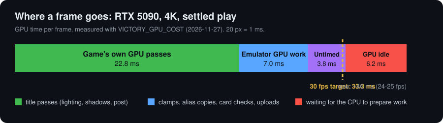

<div align="center">


[English](../../README.md) · [Français](README.fr.md) · [Español](README.es.md) · [Deutsch](README.de.md) · [Italiano](README.it.md) · **Português** · [日本語](README.ja.md) · [中文](README.zh-CN.md) · [Русский](README.ru.md)

</div>

O El1xr roda a versão de Xbox Series de Grand Theft Auto VI (build 1.0.2.1) em um PC com Windows. É o projeto de Bone/Nevaa. O próprio código x86-64 do jogo roda nativamente no seu processador. As chamadas de sistema do console, os comandos Direct3D 12.X e os shaders RDNA 2 são traduzidos para o PC enquanto o jogo roda. Não há emulação de CPU nem conteúdo do jogo neste repositório: você usa a sua própria cópia.

## Status

> [!NOTE]
> **Em 27 de novembro de 2026, GTA VI (Xbox Series, build 1.0.2.1) inicializa, chega aos menus e é jogável no mundo aberto no Windows.** Nas últimas execuções de teste com a máquina sem outra carga (lote 3, 4K, RTX 5090), o mundo roda a uma mediana de 23,5 fps, com 0 pipelines de GPU recusados. Isso ainda fica abaixo da próxima meta, 30 fps estáveis. Depois disso vêm a eliminação dos engasgos e das falhas visuais.


| Marco | Status | Evidência | Data |
|---|---|---|---|
| Executável roda | Concluído | O executável 1.0.2.1 de Xbox Series inicia no Windows. Seu código x86-64 roda nativamente. | até 24/11/2026 |
| Primeiro quadro | Concluído | A animação de abertura e as telas legais são renderizadas sem cintilação. | até 24/11/2026 |
| Menu principal | Concluído | Tela de perfil, configurações da primeira execução, telas legais, tela de carregamento e menu de pausa funcionam. Os menus rodam a 30 fps (RTX 4070 SUPER). | até 24/11/2026 |
| Jogo em andamento | Concluído | O jogo chega ao mundo aberto e o personagem se move sob o controle do jogador. Uma sessão de 13 minutos na prisão rodou a cerca de 4 fps (RTX 4070 SUPER). | até 24/11/2026 |
| Jogável | Concluído, abaixo da velocidade-alvo | O mundo roda a 23,5 fps em 4K (RTX 5090; mediana da parte no mundo de uma execução de 200 segundos do lote 3, com a máquina sem outra carga). | 27/11/2026 |
| Progresso na história | Duas primeiras missões concluídas | Um colaborador concluiu as duas primeiras missões em uma sessão de 45 minutos a cerca de 2 fps (RTX 4070 SUPER; relatado, não medido a partir dos logs). Todas as cutscenes são reproduzidas por inteiro. No Linux (Proton, RX 9070 XT), uma execução de 23 minutos passou do prólogo e chegou ao capítulo 1. | 25/11/2026 |
| 30 fps | Ainda não | 23,5 fps no mundo, tempo de quadro mediano de 42 ms contra a meta de 33,3 ms (RTX 5090, 4K). | 27/11/2026 |
| Estável | Em andamento | Com as configurações padrão, execuções de teste de 200 segundos terminam sem travamento, sem reset do driver de GPU e sem perda do dispositivo. Ao entrar no mundo ainda há uma parada de 3-9 s ([#78](https://github.com/kylepelham/El1xr/issues/78)), e as falhas visuais ainda variam de uma execução para outra (veja Problemas conhecidos). | 27/11/2026 |

## Desempenho


| Medida (RTX 5090, 4K) | Agora | Meta |
|---|---|---|
| Taxa de quadros no mundo (mediana) | **23,5 fps** | 30+ fps |
| Tempo de quadro mediano | 42 ms | 33,3 ms ou menos |
| Quadro no percentil 99 em jogo estabilizado | ~70 ms | sem engasgos |
| Tempo de CPU para preparar um quadro | 28 ms | abaixo do tempo da GPU |
| Pipelines de GPU recusados | **0** | 0 |
| Da inicialização ao primeiro quadro do mundo | 32 s | |
| Da inicialização ao jogo estabilizado | 49 s | |
| Parada ao entrar no mundo | 3-9 s ([#78](https://github.com/kylepelham/El1xr/issues/78)) | nenhuma |
| Quadros acima de 250 ms no mundo | 20 por execução | nenhum |
| Engasgos de mais de 1 s | 7 por execução | nenhum |
| Streaming após entrar no mundo | 74 s | poucos segundos |

Esses números vêm das execuções do lote 3 com a máquina sem outra carga (`python tools/dev.py bench --quiet --seconds 200`, 27 de novembro de 2026). Cada execução faz uma inicialização rápida a partir de um checkpoint fixo enquanto o resto do trabalho da máquina fica pausado, e os números são lidos do próprio log de quadros do emulador. Parte dos logs de diagnóstico estava ligada em todas as execuções. A parada ao entrar no mundo é a faixa observada nas execuções do lote 3.



O último perfil de tempos de GPU, feito antes do lote 3, indicava cerca de 40 ms por quadro estabilizado. Os passes de renderização do próprio jogo consomem 22,8 ms de tempo de GPU, o que deixa espaço para 30 fps. O restante é o trabalho de GPU do próprio El1xr (7 ms: verificação de limites em draws indiretos, cópias de texturas entre formatos, envios) e o tempo em que a GPU fica ociosa (6-10 ms) enquanto uma única thread da CPU prepara o próximo lote de trabalho. São essas duas parcelas que as próximas atualizações atacam.


O lote 3 (27 de novembro de 2026) manteve dois grupos de switches, agora ligados por padrão no inicializador: memória em seções de 2 MiB, buffers do jogo mantidos na memória da GPU e prioridade mais alta para as threads de quadro (o grupo fg_rt de sete switches), e buffers de staging, de GPU, compartilhados e de envio tirados de blocos agrupados (quatro switches). As proteções de escrita de 4 KiB também estão ligadas; elas se mostraram neutras. Contra a mesma build sem blocos agrupados, em execuções seguidas, o tempo da inicialização ao primeiro quadro do mundo caiu de 58-67 s para 32 s, o jogo estabilizado de 117-120 s para 49 s, os quadros acima de 250 ms no mundo de 51-74 para 20, os engasgos de mais de 1 s de 26-35 para 7, e o streaming de 80-87 s para 74 s. Um grupo de sete switches que rasgava as paredes da cela da prisão foi descartado. A execução do lote sem nenhum desses switches teve 14 fps e uma inicialização de 100 s, mas a máquina estava mais carregada durante ela, então não é uma comparação limpa de antes e depois.

### Máquina de teste

| Componente | Modelo |
|---|---|
| GPU | NVIDIA GeForce RTX 5090, 32 GB, driver 621.24 |
| CPU | AMD Ryzen 9 9950X3D, 16 núcleos / 32 threads |
| Memória | 64 GB DDR5-6000 |
| Placa-mãe | MSI PRO B650-P WIFI |
| Armazenamento | SSDs NVMe (Samsung 990 EVO Plus) |
| Sistema operacional | Windows 11 (build 26200) |
| Jogo | GTA VI para Xbox Series, build 1.0.2.1 (sua própria cópia) |

Todos os números atuais vêm desta máquina. Os números mais antigos deste README foram medidos em uma RTX 4070 SUPER (Windows) ou em uma RX 9070 XT (Linux), e cada um deles indica isso.

## Como funciona


- **O código do jogo** é carregado e executado como está. O Xbox Series e um PC com Windows compartilham o conjunto de instruções x86-64, então nenhuma instrução é emulada.
- **As chamadas de sistema** ao kernel do console e às bibliotecas do GDK são atendidas pela emulação de alto nível (HLE) do El1xr sobre o Windows: memória, threads, arquivos e serviços do sistema.
- **Gráficos**: as listas de comandos Direct3D 12.X, a memória e os recursos do console são reconstruídos como Direct3D 12 padrão na sua GPU.
- **Os shaders** compilados para a GPU RDNA 2 do console são traduzidos para DXIL. Todos os 26.148 programas de shader do jogo são traduzidos, e cada um fica em cache no disco depois do primeiro uso.

## Como rodar

Você precisa da sua própria cópia do jogo, Windows 10 ou 11, uma GPU com Shader Model 6.6 e mesh shaders, e Rust.

```powershell
tools\lancer_victory.ps1 -GameDir <pasta do jogo>
```

O guia completo (instalação, configurações, solução de problemas) está em [docs/running-gta6.md](../running-gta6.md).

> [!IMPORTANT]
> Este repositório não contém arquivos do jogo, chaves nem executáveis, e não explica como obtê-los.

<details>
<summary>Comandos para desenvolvedores</summary>

```powershell
python tools/dev.py build      # build de release
python tools/dev.py prewarm    # traduz todos os shaders offline (cerca de 45 s)
python tools/dev.py bench --quiet --seconds 200   # execução medida do jogo
python tools/dev.py gate       # todos os testes, falha com qualquer aviso
```

</details>

## Problemas conhecidos

- **Falhas visuais que variam de uma execução para outra.** Em cerca de metade das execuções de teste, os rostos ficam pretos ou manchados (em correção em [#35](https://github.com/kylepelham/El1xr/issues/35)), a Lucia aparece com a roupa errada na lanchonete ou o cabelo dela fica laranja na janela da prisão.
- **Uma parada ao entrar no mundo.** Logo depois que o mundo aparece pela primeira vez, o jogo congela por 3-9 s enquanto a GPU processa um lote de comandos. A causa está sendo investigada em [#78](https://github.com/kylepelham/El1xr/issues/78).
- **Streaming lento.** Depois de entrar no mundo, leva cerca de 74 s para todos os assets chegarem, com pop-in enquanto isso.
- **A GPU espera pela CPU** de 6 a 10 ms por quadro (veja o orçamento de quadro acima).
- **A iluminação com ray tracing está quase toda desligada.** O jogo constrói suas estruturas de ray tracing em software, e esse construtor está desativado por enquanto.
- **Uma única máquina de referência.** Os números atuais são da RTX 5090 acima. Outras GPUs ainda não foram medidas com a build atual.

## Próximos passos

A meta é 30 fps estáveis em 4K na RTX 5090 e, depois, nenhum engasgo e nenhuma falha visual. Cerca de 60 outras otimizações estão escritas e aguardando medição. Cada uma fica desligada por padrão até ser comprovada.

- **A parada ao entrar no mundo** ([#78](https://github.com/kylepelham/El1xr/issues/78)): descobrir qual passe desse lote de comandos de GPU leva segundos.
- **Menos espera e menos overhead**: reduzir os 6-10 ms em que a GPU espera pela CPU a cada quadro e os 7 ms de trabalho de GPU do próprio El1xr.
- **Upscaling DLSS** e **ray tracing por hardware nos RT cores**, o que traria de volta a iluminação com ray tracing.
- **Pré-aquecimento offline de shaders e pipelines**, para que nenhum shader seja compilado durante o jogo.
- **Correções para os rostos pretos ([#35](https://github.com/kylepelham/El1xr/issues/35)) e as roupas que variam de uma execução para outra**.

## Em números

| Número | O quê |
|---|---|
| 1800+ testes automatizados | ferramentas em Python e crates em Rust, executados por `dev.py gate` |
| 26.148 programas de shader | traduzidos de RDNA 2 para DXIL, em cache no disco |
| 0 pipelines recusados | na RTX 5090 |

## Como contribuir

Issues e pull requests são bem-vindos. Rode `python tools/dev.py gate` antes de abrir um pull request. As regras estão em [CONTRIBUTING.md](../../CONTRIBUTING.md). Dúvidas e relatos de testes podem ser enviados a Bone/Nevaa no Discord: **bonemeld**.

## Créditos

- **El1xr**: Bone/Nevaa.
- **VIctory**: Marvisak e seus colaboradores ([VIctory](https://github.com/Marvisak/VIctory), GPL-3.0 ou posterior), e os autores dos forks a partir dos quais ele foi montado, entre eles Neptune (VIctory Edit.), de Traffic & zm0kie.
- **AnyXboxX**: Looper_Salty e seus colaboradores, o projeto do qual o El1xr é um fork.
- **Os forks do VIctory com os quais aprendemos e dos quais portamos código**, entre eles fxceless/victory-fork, Peppacodes, Belobug, stellarr-studio/kelvaroq, uiliannn/VItoriaBr, DoubleGhosty/cool_fox, avatarmanz, 3cvil/M1LK, trustno1-coder, TaynanGT/Vice-Tay, Linox-IDK/LNX-victory e readmet3xt-lab/foxhound.
- Cada componente e autor, mudança por mudança, é creditado em [THIRD_PARTY.md](../../THIRD_PARTY.md). A história anterior do projeto está em [docs/history.md](../history.md).

## Licença

O El1xr é distribuído sob a [GNU GPL 3.0 ou posterior](../../LICENSE). Partes de terceiros mantêm sua própria licença: o módulo `Task` da libHttpClient (MIT, `runtime/third_party/libhttpclient-task`) e as tabelas RDNA 2 geradas a partir dos testes públicos de codificação do LLVM (Apache 2.0 com exceção LLVM, `PrototypeScarlett/emu/rdna2_ops.py` e `rdna2_shapes.py`).
