<div align="center">




[English](../../README.md) · [Français](README.fr.md) · [Español](README.es.md) · [Deutsch](README.de.md) · [Italiano](README.it.md) · [Português](README.pt-BR.md) · [日本語](README.ja.md) · **中文** · [Русский](README.ru.md)

</div>

El1xr 让 Xbox Series 版 Grand Theft Auto VI（版本 1.0.2.1）在 Windows PC 上运行，是 Bone/Nevaa 的项目。游戏自身的 x86-64 代码在你的处理器上以原生方式运行；它的主机系统调用、Direct3D 12.X 命令和 RDNA 2 着色器则在游戏运行时被翻译为 PC 可用的形式。本项目不做 CPU 模拟，本仓库也不包含任何游戏内容：你需要使用自己的游戏副本。

## 现状

> [!NOTE]
> **截至 2026 年 11 月 28 日，GTA VI（Xbox Series，版本 1.0.2.1）已能在 Windows 上启动、进入菜单，并在开放世界中游玩。** 在最近一批无其他负载的测试运行中（第 5 批，4K，RTX 5090），游戏在从启动开始的 110 秒运行中达到 21.6-22.4 fps，在 180 秒和 460 秒的运行中达到 25.8-26.0 fps。这仍未达到下一个目标：稳定的 30 fps。之后是消除卡顿和画面错误。


| 里程碑 | 状态 | 依据 | 日期 |
|---|---|---|---|
| 可执行文件运行 | 已完成 | Xbox Series 1.0.2.1 的可执行文件可在 Windows 上启动，其 x86-64 代码以原生方式运行。 | 2026 年 11 月 24 日前 |
| 第一帧 | 已完成 | 启动动画和法律声明画面渲染正常，没有闪烁。 | 2026 年 11 月 24 日前 |
| 主菜单 | 已完成 | 档案画面、首次运行设置、法律声明画面、加载画面和暂停菜单全部正常工作。菜单以 30 fps 运行（RTX 4070 SUPER）。 | 2026 年 11 月 24 日前 |
| 进入游戏 | 已完成 | 游戏可进入开放世界，角色可由玩家操控移动。在监狱中进行的一次 13 分钟游戏约为 4 fps（RTX 4070 SUPER）。 | 2026 年 11 月 24 日前 |
| 可游玩 | 已完成，速度未达目标 | 游戏可在 4K 下以 21.6-26.0 fps 游玩（RTX 5090；第 5 批无其他负载的 110 至 460 秒运行）。 | 2026 年 11 月 28 日 |
| 剧情进度 | 已完成前两个任务 | 一位贡献者在一次约 2 fps 的 45 分钟游戏中完成了前两个任务（RTX 4070 SUPER；为本人报告，并非根据日志测得）。所有过场动画均可完整播放。在 Linux（Proton，RX 9070 XT）上，一次 23 分钟的运行通过了序章，进入第 1 章。 | 2026 年 11 月 25 日 |
| 30 fps | 尚未达到 | 21.6-26.0 fps，即每帧 38-46 ms，目标为 33.3 ms（RTX 5090，4K）。 | 2026 年 11 月 28 日 |
| 稳定 | 进行中 | 使用默认设置时，第 5 批的测试运行没有出现 GPU 驱动重置或设备丢失。第 5 批早期在 5 次运行中 5 次出现的进入世界时 8-9 秒停顿，在开始检查原始间接记录之后检查过的 47 次启动中没有再出现。当 Windows 的内存提交耗尽时，游戏仍可能崩溃，画面错误也仍会因每次运行而异（见“已知问题”）。 | 2026 年 11 月 28 日 |

## 性能



| 指标（RTX 5090，4K） | 当前 | 目标 |
|---|---|---|
| 从启动开始的 110 秒运行的帧率 | **21.6-22.4 fps** | 30+ fps |
| 180 秒和 460 秒运行的帧率 | **25.8-26.0 fps** | 30+ fps |
| 准备一帧的 CPU 时间 | 15.7-21.2 ms | 低于 GPU 时间 |
| 被拒绝的 GPU 管线 | 1 | 0 |
| 从启动到世界第一帧 | 23.1-24.6 s | |
| 进入世界时的停顿 | 47 次启动中均未出现；单次运行的最差帧 771-832 ms | 无卡顿 |
| 世界内超过 250 ms 的帧 | 每次 110 秒运行 3-6 帧 | 无 |
| 餐馆中的单帧变暗闪烁 | 0（此前每次运行 12-19 次） | 无 |
| 180 秒后的 GPU 缓冲区内存 | 2.9 GB（此前为 4.5 GB） | |

这些数据来自第 5 批（2026 年 11 月 28 日完成），使用启动器现在默认开启的开关。每次运行都在无其他负载的条件下进行：机器上的其他工作被暂停或压低，游戏从固定的存档点快速启动，数据读取自模拟器自身的帧日志（帧率和 CPU 时间取一次运行中世界内后半段帧的中位数）。110 秒的数据来自两组连续进行的加载对比运行，180 秒的数据来自 `CARD_BLOCK_REUSE` 的对比运行，460 秒的数据来自一次 CPU 测试启动。帧率取决于场景和运行时长，因此只应在同一组对比运行内比较数据。每次运行都开启了部分诊断日志。


在第 3 批之前采集的最近一次 GPU 时间剖析中，稳定后的一帧约需 40 ms，其中游戏自身的渲染通道占 22.8 ms。第 5 批表明，现在限制帧率的是准备和提交一帧的 CPU 工作，而不是 GPU：在 DLSS 以 4K 的三分之二分辨率渲染时，实际帧率仍为 21.8-22.0 fps，与原生 4K（20.1-22.2 fps）相同。因此，第 5 批保留的改动大多是在削减每帧的 CPU 时间。


第 5 批保留了以下改动，现已在启动器中默认开启。第 3 批和第 4 批的开关继续保持开启。

- **更快的加载**（`VICTORY_TEXTURE_HEAPS=1`、`VICTORY_TEXTURE_BLOCK_THREAD=1`、`VICTORY_DSTORAGE_STAGING_MB=256`、`VICTORY_DSTORAGE_POLL_WAIT=1`、`VICTORY_BAKE_STAGE_ALL=1`）：流式加载的纹理共享在独立线程上创建的大内存块；同时进行中的 DirectStorage 读取最多为 256 MiB，而不是 32 MiB；游戏轮询已完成的磁盘读取时，读取一完成就立即返回；烘焙通道在加载期间集中暂存。在用于确认的无负载对比运行中，帧率不变，从启动到世界第一帧由 26.7 秒缩短至 24.6 秒，从启动到第一帧完整的世界画面由 29.2 秒缩短至 26.2 秒，最差帧由 1049 ms 降至 832 ms。第一组对比运行的结果一致（由 26.2 秒缩短至 23.1 秒）。
- **修复餐馆闪烁**（`VICTORY_TABLE_NULL_ONCE=1`）：在餐馆中，背景大约每 2 秒变暗一帧，每次运行 12-19 次。原因是每当某个纹理的准备工作被裁剪掉时，描述符表就会清空该纹理的槽位；现在一个槽位最多只清空一次。开启此开关后，在一次 110 秒运行和两段 18 秒的测试片段中都没有再出现这样的帧，也没有可测量的代价。
- **消除进入世界时的停顿**（`VICTORY_RAW_CHECK=2`）：由游戏着色器写入的间接绘制记录会在执行前接受检查。第 5 批早期，每次运行都会在进入世界约 4 秒后冻结 8.2-9.0 秒（5 次中 5 次）；此改动之后检查过的 47 次启动中没有一次出现停顿。
- **减少每帧的 CPU 时间**：
  - `VICTORY_SKIP_WC_BACK=1`：对写合并内存的大块着色器写入留在显卡上，不再复制回来。2 次运行中 2 次达到 24.6 fps，而不开此开关时最好的无负载运行为 21.5 fps，每帧 CPU 时间减少 7.3 ms。
  - `VICTORY_CARD_BLOCK_REUSE=1`：GPU 内存块被清零后复用，而不是重新分配。在一组无负载的 180 秒对比运行中，帧率由 23.6 fps 提升至 26.0 fps，结束时的 GPU 缓冲区内存为 2.9 GB，而不是 4.5 GB。
  - `VICTORY_SEND_THREAD=1` 和 `VICTORY_CARD_RECORD_SEND=1`：命令列表的提交和 GPU 同步列表的录制在独立线程上进行。帧线程上的提交时间由 1.56 ms 降至 0.11 ms。
  - `VICTORY_FLUSH_BESIDE=1`、`VICTORY_RESET_ASIDE=1`、`VICTORY_COPIED_SHARED=1`、`VICTORY_TEXTURE_HASH_BEHIND=1`、`VICTORY_RESULT_RING=1`，以及 `VICTORY_WIDE_WAKE_ONE=1` 搭配 `VICTORY_WAIT_SPIN=50`：每项带来较小的改善，每帧 CPU 时间减少 0.5-1.8 ms，或帧率最多提高 1.4 fps，均通过在同一次运行中开关各项来测量。
- **更快进入世界**（`VICTORY_HEAP_WARM=1`）：游戏视图堆的宿主机副本在加载画面期间创建，因此世界第一帧耗时 614 ms，而不是 1048 ms（第二组对比运行；第一组由 781 ms 降至 702 ms）。
- **更少的慢帧**（`VICTORY_AMBIENT_ONCE=1`）：游戏环境光照的替代实现只计算一次反弹。在同一次运行内的测试中，第 99 百分位帧时间降低了 11 ms。

在 4K 下开启超分辨率不再崩溃：三次开启超分辨率的启动都没有出现除以零（0xc0000094）。DLSS 超分辨率画面清晰，但不会提高帧率，因为帧在等待 CPU。DLSS 帧生成（`-FrameGen`，或在 F9 菜单中设置 Frame generation = dlss）可以从 22-24 个真实帧呈现约 44-47 fps；在人工目视检查生成的帧之前，它默认保持关闭。第 5 批还弃用了一些造成问题或拖慢速度的开关，其中包括 `PIPELINE_PIECES`（黑屏）、`BAKE_SPREAD=12`（慢 1.2-2.2 fps）和 `GUARD_PUBLISH_TRY`（崩溃）。游戏的光线追踪构建器开启后可以工作，但只有 0.6-1.1 fps，因此保持关闭。

### 测试机器

| 部件 | 型号 |
|---|---|
| GPU | NVIDIA GeForce RTX 5090，32 GB，驱动 621.24 |
| CPU | AMD Ryzen 9 9950X3D，16 核 / 32 线程 |
| 内存 | 64 GB DDR5-6000 |
| 页面文件 | 64 GB（提交上限 142 GB） |
| 主板 | MSI PRO B650-P WIFI |
| 存储 | NVMe SSD（Samsung 990 EVO Plus） |
| 操作系统 | Windows 11（版本 26200） |
| 游戏 | Xbox Series 版 GTA VI，版本 1.0.2.1（你自己的副本） |

当前所有数据均来自这台机器。本 README 中较早的数据是在 RTX 4070 SUPER（Windows）或 RX 9070 XT（Linux）上测得的，每处都已注明。

## 工作原理



- **游戏代码**按原样加载和运行。Xbox Series 与 Windows PC 使用相同的 x86-64 指令集，因此无需模拟任何指令。
- **系统调用**：对主机内核和 GDK 库的调用由 El1xr 基于 Windows 的高层模拟（HLE）处理，涵盖内存、线程、文件和系统服务。
- **磁盘读取**：游戏的 DirectStorage 请求由 El1xr 自己的工作线程处理，同时进行中的读取最多 256 MiB。流式加载的纹理被放入共享内存块：一次典型运行中约有 115,000 个纹理，分布在 116 个块中。
- **图形**：主机的 Direct3D 12.X 命令列表、内存和资源在你的 GPU 上被重建为标准的 Direct3D 12。命令列表从独立线程提交，因此游戏的帧线程承担的这部分工作更少。
- **描述符堆**：游戏最多寻址 1,245,184 个描述符槽位（它的纹理和缓冲区视图表）。El1xr 将它们镜像到一个约 1,000,000 个槽位的宿主机堆中，与自己的视图共用，并在加载画面期间创建宿主机副本。如何容纳其余部分仍未解决（见“已知问题”）。
- **着色器**：为主机 RDNA 2 GPU 编译的着色器会被翻译为 DXIL。游戏 26,148 个着色器程序中除 6 个外均可翻译，每个翻译结果都会缓存到磁盘。`dev.py prewarm` 在运行前构建游戏的 25,751 条 GPU 管线，因此游戏过程中不会编译它们。

## 运行

你需要自己的游戏副本、Windows 10 或 11、支持 Shader Model 6.6 和网格着色器的 GPU，以及 Rust。

```powershell
tools\lancer_victory.ps1 -GameDir <游戏文件夹>
```

完整指南（安装、设置、故障排除）见 [docs/running-gta6.md](../running-gta6.md)。

> [!IMPORTANT]
> 本仓库不包含任何游戏文件、密钥或可执行文件，也不说明如何获取它们。

<details>
<summary>开发者命令</summary>

```powershell
python tools/dev.py build      # release 构建
python tools/dev.py prewarm    # 离线翻译全部着色器（约 45 s）
python tools/dev.py bench --quiet --seconds 200   # 带测量的游戏运行
python tools/dev.py gate       # 全部测试，出现任何警告即失败
```

</details>

## 已知问题

- **序章之后监狱窗台变暗**：在 PROLOGUE 标题之后的牢房镜头中，镜头不变，被阳光照亮的窗台却在相邻两帧之间变暗并失去细节。第 5 批中复现了两次；原因正在调查。
- **皮肤可能变黑**：在某些运行中，角色的皮肤（最常见于餐馆）会变成纯黑几秒，然后恢复（[#35](https://github.com/kylepelham/El1xr/issues/35)）。女服务员衬衫的颜色也会因每次运行而异。
- **窗户上的暗色方块**：在开场过场动画约 44 秒处，阶梯状的暗色方块覆盖了 Jason 身后的窗户。第 5 批排除了两个疑似原因，排查仍在继续。
- **描述符堆上限**：游戏最多寻址 1,245,184 个描述符槽位，但 RTX 5090 上的宿主机堆只能容纳约 1,000,000 个。在第 5 批的运行中，游戏有 313,000-504,000 个活动视图位于宿主机堆能容纳的范围之外。目前还没有保留下来的容纳方案。
- **手机屏幕是黑的**：出现在餐馆的餐桌镜头中。
- **内存占用高**：游戏进程峰值为 33-35 GB。页面文件太小时，游戏会在 Windows 内存提交耗尽时崩溃。测试 PC 使用 64 GB 的页面文件。
- **流式加载缓慢**：进入世界后，所有资源到齐大约需要 72 秒，在此期间会出现物体突然弹出的现象。
- **帧在等待 CPU**：准备和提交一帧需要 15.7-21.2 ms 的 CPU 时间，因此超分辨率无法提高帧率。
- **光线追踪光照已关闭**：游戏在软件中构建其光线追踪结构；这个构建器可以工作，但只有 0.6-1.1 fps，因此保持关闭。
- **仅有一台参考机器**：当前数据来自上述 RTX 5090，其他 GPU 尚未用当前版本测量。

## 下一步

目标是在 RTX 5090 上以 4K 稳定运行在 30 fps，然后消除卡顿和画面错误。每项新改动在无负载测试运行证明其效果之前都默认关闭。

- **减少每帧的 CPU 时间**：帧受 CPU 限制，因此接下来的几批会继续把提交工作和纹理检查工作移出帧线程。
- **窗台和窗户方块问题**，以及**变黑的皮肤**（[#35](https://github.com/kylepelham/El1xr/issues/35)）。
- **描述符堆**：把游戏的 1,245,184 个槽位放进宿主机堆。
- **在 RT 核心上进行硬件光线追踪**，这将恢复光线追踪光照。
- **默认开启 DLSS 帧生成**：在人工目视检查其生成的帧之后。

## 项目数据

| 数字 | 内容 |
|---|---|
| 4000+ 项测试通过 | Rust crate（`cargo test`）和 Python 工具（`pytest`），由 `dev.py gate` 运行 |
| 26,148 个着色器程序 | 从 RDNA 2 翻译为 DXIL，缓存在磁盘上；有 6 个尚无法翻译 |
| 25,751 条 GPU 管线 | 由 `dev.py prewarm` 在游戏开始前构建 |
| 1 个被拒绝的管线 | 在 RTX 5090 上，最近的运行中 |

## 参与贡献

欢迎提交 issue 和 pull request。提交 pull request 前请先运行 `python tools/dev.py gate`。规则见 [CONTRIBUTING.md](../../CONTRIBUTING.md)。问题和测试报告请在 Discord 上发给 Bone/Nevaa：**bonemeld**。

## 致谢

- **El1xr**：Bone/Nevaa。
- **VIctory**：Marvisak 及其贡献者（[VIctory](https://github.com/Marvisak/VIctory)，GPL-3.0 或更高版本），以及组装它所用的各个分支的作者，其中包括 Traffic & zm0kie 的 Neptune (VIctory Edit.)。
- **AnyXboxX**：Looper_Salty 及其贡献者，El1xr 即从该项目分支而来。
- **我们学习并移植过代码的 VIctory 分支**，其中包括 fxceless/victory-fork、Peppacodes、Belobug、stellarr-studio/kelvaroq、uiliannn/VItoriaBr、DoubleGhosty/cool_fox、avatarmanz、3cvil/M1LK、trustno1-coder、TaynanGT/Vice-Tay、Linox-IDK/LNX-victory、readmet3xt-lab/foxhound、RipcuBAN/victory-fork 和 Kemerd/VIctory-NVIDIA-RT。
- 每个组件和作者都按每次改动在 [THIRD_PARTY.md](../../THIRD_PARTY.md) 中注明。项目早期的历史见 [docs/history.md](../history.md)。

## 许可证

El1xr 以 [GNU GPL 3.0 或更高版本](../../LICENSE) 发布。第三方部分保留各自的许可证：libHttpClient 的 `Task` 模块（MIT，`runtime/third_party/libhttpclient-task`），以及根据 LLVM 公开编码测试生成的 RDNA 2 表（Apache 2.0 with LLVM exception，`PrototypeScarlett/emu/rdna2_ops.py` 和 `rdna2_shapes.py`）。
